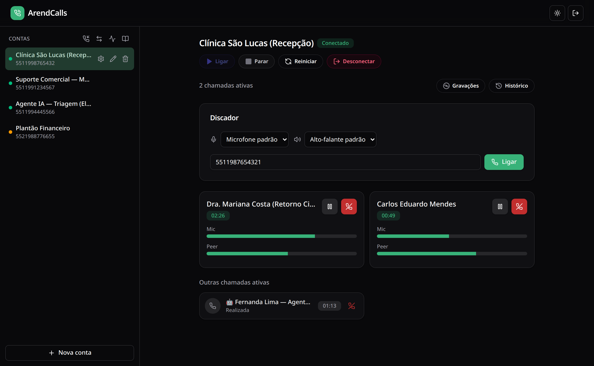
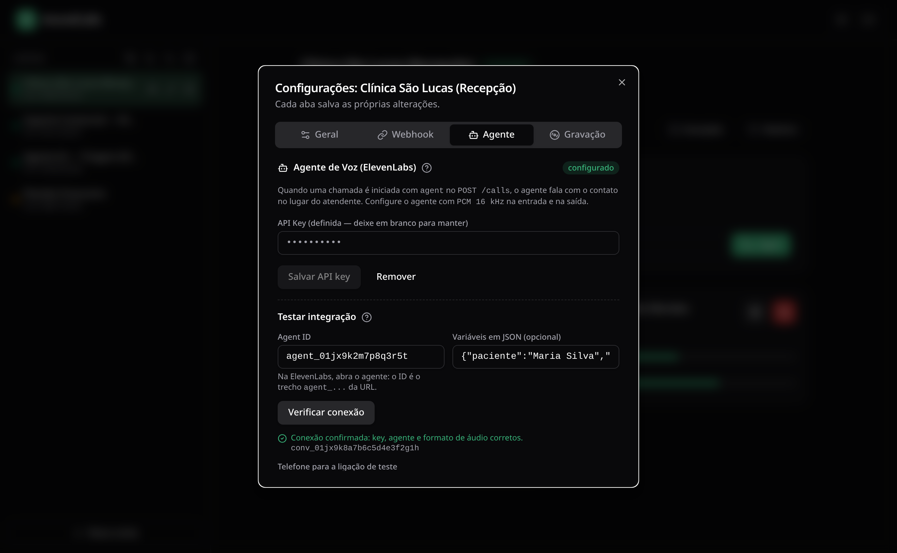
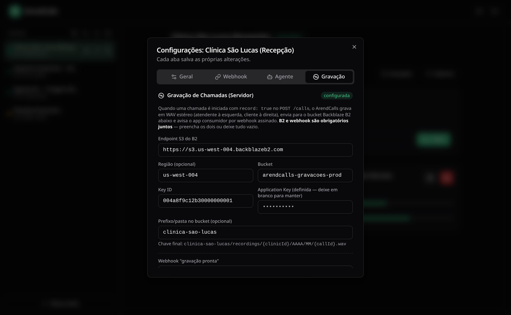
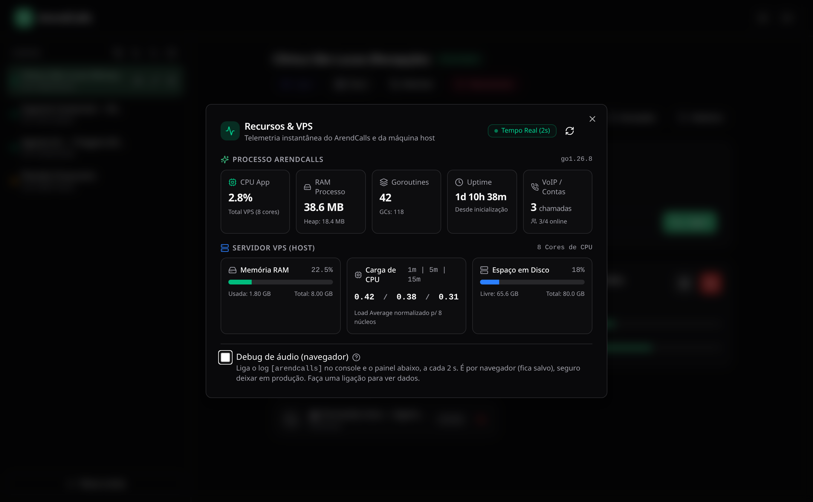
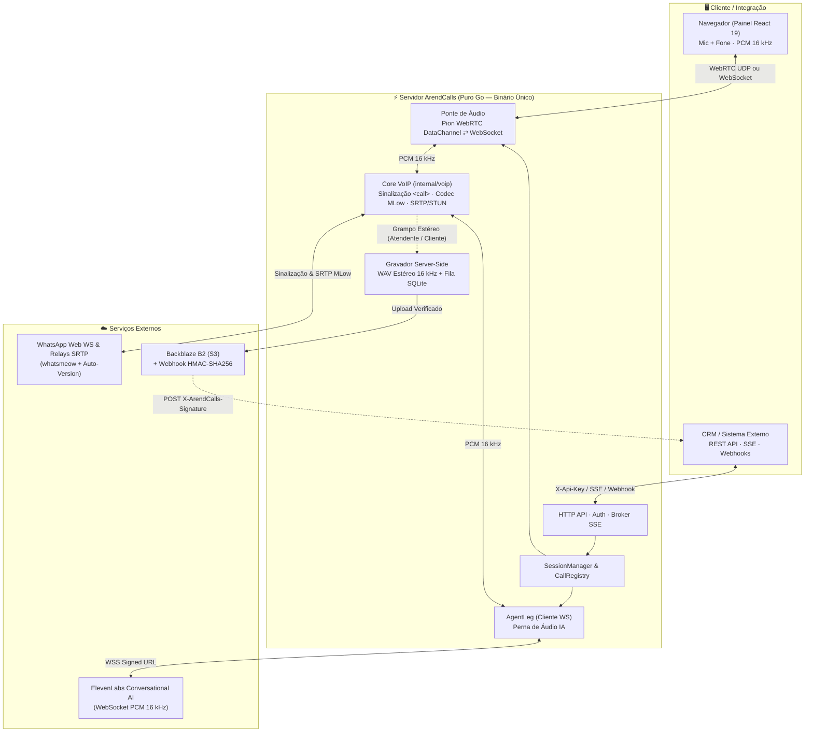

<div align="center">

# 📞 ArendCalls

**Chamadas de voz nativas do WhatsApp em puro Go e React 19 — com Agente de Voz IA (ElevenLabs), Gravação Estéreo no Servidor e Serviço Nativo para Windows.**
*Fork corporativo de alta performance baseado no [WaCalls](https://github.com/jotadev66/wacalls)*

[](https://github.com/nathanarend/ArendCalls/releases/latest)
[](https://github.com/nathanarend/ArendCalls/actions/workflows/ci.yml)
[](#windows)
[](https://hub.docker.com/r/nathanarend/arendcalls)
[](https://github.com/nathanarend/ArendCalls/pkgs/container/arendcalls)
[](https://go.dev)
[](https://react.dev)
[](#agente-voz)
[](#licenca)

[**📦 Baixar Pacotes Prontos (Windows / Linux)**](https://github.com/nathanarend/ArendCalls/releases/latest) · [**🪟 Windows (Serviço + Bandeja)**](#windows) · [**🐳 Início Rápido (Docker)**](#inicio-rapido) · [**🤖 Agente de Voz IA**](#agente-voz) · [**🎙️ Gravação B2**](#gravacao) · [**☁️ Cloudflare Tunnel**](#cloudflare-tunnel) · [**📡 Rotas da API**](#endpoints)

<br/>



</div>

---

## 🖼️ Visão Geral da Interface

<table>
  <tr>
    <td width="33%" align="center">
      
      <br/>
      <sub><b>🤖 Agente de Voz (ElevenLabs)</b><br/>Teste de conexão sem discar, variáveis dinâmicas e chamada assistida por IA.</sub>
    </td>
    <td width="33%" align="center">
      
      <br/>
      <sub><b>🎙️ Gravação Estéreo no Servidor</b><br/>WAV 16 kHz (atendente/cliente separados) com upload direto para Backblaze B2 + Webhook HMAC.</sub>
    </td>
    <td width="33%" align="center">
      
      <br/>
      <sub><b>📊 Telemetria sob Demanda</b><br/>CPU, RAM, goroutines, disco e chamadas ativas em tempo real (zero overhead em background).</sub>
    </td>
  </tr>
</table>

---

<a id="sobre"></a>
## 💡 Sobre o Projeto

O **ArendCalls** permite conectar uma ou mais contas de WhatsApp via **QR code** e realizar e receber **chamadas de voz 1:1** diretamente de qualquer navegador na rede, via **Agente de Voz ElevenLabs** ou integradas ao seu CRM por API REST, Webhooks e SSE.

O áudio do microfone do navegador é transmitido como **PCM 16 kHz bruto** (via canal de dados **WebRTC** ou **WebSocket** com fallback automático) até o servidor Go. O servidor codifica o áudio utilizando o codec **MLow** da Meta e o injeta na malha de **relays SRTP do WhatsApp**. No fluxo inverso, o áudio do interlocutor é decodificado e reproduzido em tempo real.

Todo o ecossistema VoIP roda **nativamente em puro Go**:
- **Codec de voz MLow embutido** (otimizado — **−63% de CPU no encode** desde a v2026.20, saída byte a byte idêntica)
- **Empacotamento RTP/SRTP e STUN** + transporte de relay WebRTC/SCTP
- **Sinalização `<call>` integrada ao [whatsmeow](https://github.com/tulir/whatsmeow)** com **auto-update diário da versão do WhatsApp Web**
- **Serviço nativo para Windows (`ArendCalls.exe`)** com ícone na bandeja do sistema (System Tray), inicialização automática no boot sem usuário logado e auto-restart
- **Gravação da chamada no servidor** (WAV estéreo) com upload direto para o Backblaze B2 — opcional, por chamada
- **Sem necessidade de CGO, compiladores C ou DLLs externas** (binários 100% estáticos para Windows, Linux x64/ARM64 e macOS)

> [!TIP]
> **Windows com 1 duplo clique + acesso externo sem abrir portas:**
> Baixe o `.zip` da [última Release](https://github.com/nathanarend/ArendCalls/releases/latest) e execute o **`ArendCalls.exe`**: ele instala o servidor como **Serviço do Windows** (sobe sozinho junto com o PC mesmo sem ninguém logado) e adiciona o **ícone de status na bandeja do sistema**. Combine com o [**Cloudflare Tunnel**](#cloudflare-tunnel) para acessar via `https://` de qualquer lugar sem IP fixo, roteador ou portas abertas!

> [!TIP]
> **Compatível em paralelo com WAHA / Evolution API no mesmo número:**
> Graças à arquitetura Multi-Device (MDv2) do WhatsApp, o **ArendCalls pode ser utilizado em paralelo ao [WAHA](https://waha.devlike.pro/)** ou Evolution API na mesma conta, **sem qualquer interferência**. O WAHA gerencia mensagens de texto, mídias e automações de chat, enquanto o ArendCalls atua de forma independente e dedicada exclusivamente às **chamadas de voz VoIP nativas**.

---

<a id="diferenciais"></a>
## 🚀 Principais Recursos e Diferenciais

Este repositório (`ArendCalls`) traz diversas evoluções de arquitetura, automação e operação corporativa em relação ao projeto original:

### 🪟 Operação Nativa & Deploy Flexível
| Recurso | Detalhes |
|---|---|
| 🪟 **App Nativo para Windows (Serviço + Bandeja)** | O lançador **`ArendCalls.exe`** instala o ArendCalls como **Serviço do Windows** (`SYSTEM`): sobe sozinho no boot **mesmo sem ninguém logado**, reinicia automaticamente se cair, blinda as permissões (ACL) da pasta, configura o Firewall do Windows e exibe um **ícone semáforo na bandeja (System Tray)** (🟢 no ar · 🟡 conta aguardando QR/atenção · 🔴 parado · 🔵 iniciando) com menu rápido para painel, `.env` e logs. |
| 📦 **Pacotes Prontos (Extrair e Executar)** | Releases oficiais com pacotes `.zip` (Windows x64) e `.tar.gz` (Linux x64 e ARM64) contendo binário do servidor, painel React já compilado, lançador/script e `.env.example`. Atualização limpa extraindo por cima sem sobrescrever seu `.env` ou `wacalls.db`. |
| ☁️ **Windows + Cloudflare Tunnel** | Painel e chamadas acessíveis pela internet a partir de qualquer Windows atrás de NAT/CGNAT, sem abrir portas no roteador nem IP fixo, combinando `cloudflared` como serviço + transporte de áudio WebSocket. |
| 🐳 **DockerHub & GHCR Prontos para Produção** | Imagens multi-arch leves publicadas no DockerHub (`nathanarend/arendcalls`) e GitHub Container Registry (`ghcr.io/nathanarend/arendcalls`), binário estático sem CGO e labels prontos para Traefik. |

### 🤖 Inteligência Artificial, Gravação & Áudio
| Recurso | Detalhes |
|---|---|
| 🤖 **Agente de Voz IA (ElevenLabs)** | Chamadas de saída podem ser atendidas diretamente por um agente conversacional da **ElevenLabs** (`agent` no `POST /calls`), com variáveis dinâmicas (`{{nome}}`), teste de conexão sem discar (`POST .../agent-test`), API key cifrada por conta e **transbordo imediato para humano** ao abrir o áudio no painel. [Detalhes](#agente-voz). |
| 🎙️ **Gravação Estéreo no Servidor (B2 + HMAC)** | Grava a chamada no servidor em **WAV estéreo 16 kHz** (canal esquerdo = atendente/agente IA, direito = cliente), faz upload com fila durável em SQLite para o **Backblaze B2** e notifica via **webhook assinado (HMAC-SHA256)**. Zero carga no navegador. [Detalhes](#gravacao). |
| 🎧 **Transporte de Áudio Automático (WebRTC ➔ WebSocket)** | O painel tenta **WebRTC** (UDP de baixa latência) e, se o DataChannel não abrir em 4 s (ex: proxy/Cloudflare Tunnel), faz **fallback transparente para WebSocket** sem derrubar a chamada, memorizando a rota por 30 min + **pré-buffer configurável** anti-jitter (DTX). [Detalhes](#transporte-audio). |
| ⚡ **Codec MLow Otimizado (−63% CPU)** | Encode ~2,7× mais rápido (memoização de twiddles do FFT + pool de scratch na busca CELP) com saída de áudio byte a byte idêntica, permitindo muito mais chamadas simultâneas por núcleo. |
| ⏸️ **Modo Espera (Hold) & Anti-Duplicidade (`409`)** | Botão e rota `/hold` · `/unhold` para colocar o cliente em espera com áudio de aguardo. Proteção nativa (`409 Conflict`) que impede discagens simultâneas duplicadas para o mesmo número na mesma conta. |

### 🏢 Estabilidade WhatsApp, Segurança & Gerenciamento
| Recurso | Detalhes |
|---|---|
| 🔄 **Auto-Update da Versão do WhatsApp Web** | Busca automaticamente a versão ativa em `web.whatsapp.com` no boot, após erro `405 (Client Outdated)` e diariamente às 03h (`WA_VERSION_CHECK_HOUR`), reconectando sessões em fila serial sem interromper chamadas ativas. |
| 🟢 **Keepalive Anti-Desconexão & Presença Invisível** | Pulso automático de presença (`available` por 30s ➔ `unavailable`) ao conectar, ao parear e no worker diário: atualiza a última atividade em *"Aparelhos conectados"* evitando a expiração de 14 dias do WhatsApp, sem exibir status "online" para os contatos. |
| 🤝 **Paralelo com WAHA Sem Interferência** | Opera simultaneamente com o WAHA ou Evolution API no mesmo número de WhatsApp. O WAHA cuida das mensagens/mídias e o ArendCalls cuida exclusivamente das ligações de voz. |
| 🚚 **Migração entre Servidores (Zero QR)** | Clone atômico 1-clique pelo painel (`⇄`) de um servidor para outro: transfere sessões com chaves criptográficas (sem escanear QR de novo), webhooks, configs e WAVs pendentes, com lock na origem e rollback automático se o destino não conectar. [Detalhes](#migracao). |
| 🛡️ **Autenticação Unificada & Criptografia AES-GCM** | Login no painel web com senha (`bcrypt` + rate-limit progressivo por IP/Cloudflare), chave mestra (`API_KEY`) para backend, tickets descartáveis de 30s para WebSocket de áudio e criptografia `AES-256-GCM` (`RECORDING_CONFIG_KEY`) para chaves do B2 e ElevenLabs no SQLite. |
| 📴 **Controle de Chamadas Recebidas no Painel** | Interruptor global para silenciar chamadas recebidas no painel web (com override por conta), permitindo usar o painel apenas como console admin enquanto Webhooks e SSE continuam recebendo tudo. |
| 🇧🇷 **Interface 100% em Português + Guia de API** | Painel React 19 em pt-BR (temas Claro/Escuro), gerenciador visual multi-instâncias, modal de telemetria da VPS sob demanda e documentação interativa da API embutida na própria interface. |

---

<a id="instalacao-pacotes"></a>
## 📦 Instalação Rápida: Pacotes Prontos (Windows e Linux)

Cada release na [página de Releases](https://github.com/nathanarend/ArendCalls/releases/latest) traz pacotes prontos **"extrair e executar"** com o servidor, o painel web já compilado e um `.env.example` (no Windows inclui o lançador nativo `ArendCalls.exe`; no Linux o script `iniciar.sh`):

| Plataforma | Pacote na Release | Como Iniciar |
|---|---|---|
| 🪟 **Windows x64** (10+ / Server 2016+) | `arendcalls-<versão>-windows-amd64.zip` | Extrair em `C:\ArendCalls` e dar duplo clique em **`ArendCalls.exe`** ([guia completo abaixo](#windows)) |
| 🐧 **Linux x64** | `arendcalls-<versão>-linux-amd64.tar.gz` | Extrair e rodar `./iniciar.sh` |
| 🐧 **Linux ARM64** | `arendcalls-<versão>-linux-arm64.tar.gz` | Extrair e rodar `./iniciar.sh` |

> [!NOTE]
> O arquivo `.env` não vem dentro do pacote para nunca sobrescrever suas configurações: na primeira execução ele é criado automaticamente. Para atualizar de versão, basta extrair o pacote novo por cima da pasta atual — o `.env`, o banco `wacalls.db` e a pasta `recordings` permanecem intactos.

---

<a id="windows"></a>
## 🪟 Windows Nativo: Serviço + Ícone na Bandeja (`ArendCalls.exe`)

No Windows 10+ e Windows Server 2016+, o pacote instala o ArendCalls como um **Serviço Nativo do Windows**:
- **Sobe sozinho com o Windows no boot**, mesmo sem nenhum usuário logado na máquina;
- **Auto-restart:** reinicia o servidor automaticamente caso o processo caia;
- **Ícone na bandeja do sistema (System Tray)** perto do relógio para cada usuário logado;
- **Segurança automática:** gera `API_KEY` aleatória na instalação, restringe a permissão de escrita da pasta apenas a Administradores/`SYSTEM` e gerencia as regras do Firewall do Windows.

### Passo a Passo no Windows

1. Baixe `arendcalls-<versão>-windows-amd64.zip` nas [Releases](https://github.com/nathanarend/ArendCalls/releases/latest) e extraia em um caminho fixo, como **`C:\ArendCalls`** *(não execute de dentro do `.zip` nem da pasta Downloads)*.
2. Dê **duplo clique em `ArendCalls.exe`**, clique em **Sim** para instalar o serviço e confirme a permissão de Administrador (UAC).
3. Pronto! O serviço já está rodando em background e o ícone aparece na bandeja do sistema. Clique com o **botão esquerdo** no ícone da bandeja para abrir o painel em `http://localhost:8080`.

### Semáforo de Status e Menu da Bandeja

| Cor do Ícone | Significado |
|---|---|
| 🟢 **Verde** | Servidor no ar e todas as contas do WhatsApp conectadas |
| 🟡 **Amarelo** | Servidor no ar, mas alguma conta do WhatsApp precisa de atenção (desconectada ou aguardando leitura de QR Code) |
| 🔴 **Vermelho** | Serviço parado ou servidor sem resposta |
| 🔵 **Azul** | Serviço iniciando |
| ⚪ **Cinza** | Serviço ainda não instalado |

Clicando com o **botão direito** no ícone da bandeja, você acessa:
- **Abrir painel** (`http://localhost:8080`)
- **Editar configuração (`.env`)** *(abre o Bloco de Notas já como Administrador)*
- **Reiniciar servidor** / **Parar servidor**
- **Ver log do servidor** (`logs\servidor.log`) / **Ver log da bandeja** (`%LOCALAPPDATA%\ArendCalls\lancador.log`)
- **Fechar só o ícone** *(tira o ícone da bandeja, mas o servidor continua rodando em background)*
- **Encerrar tudo** *(para o serviço do servidor e fecha o ícone; um novo duplo clique em `ArendCalls.exe` sobe tudo novamente)*

<details>
<summary>⚙️ <b>Detalhes de Configuração (.env), Login, Firewall e Linha de Comando no Windows</b> (clique para expandir)</summary>

<br/>

| Arquivo na Pasta | Finalidade |
|---|---|
| `ArendCalls.exe` | Gerenciador do Serviço do Windows + Ícone da Bandeja |
| `arendcalls-server.exe` | Binário do servidor VoIP (gerenciado pelo serviço; não abra diretamente) |
| `.env` | Arquivo de configuração lido a cada partida do servidor |
| `wacalls.db` e `recordings\` | Banco SQLite das contas do WhatsApp e fila local de gravações WAV |
| `logs\servidor.log` | Log do servidor com rotação automática a cada 10 MB |

> [!IMPORTANT]
> No arquivo `.env`, linhas iniciadas com `#` são **comentários ignorados**. Para ativar uma opção comentada (como `ADMIN_USER`, `ADMIN_PASSWORD_HASH` ou `RECORDING_CONFIG_KEY`), **apague o `# ` do início da linha** (`# ADMIN_USER=admin` ➔ `ADMIN_USER=admin`). Use formato `CHAVE=valor`, sem aspas, salve pelo menu *Editar configuração (.env)* e clique em *Reiniciar servidor*.

- **`API_KEY`**: Chave secreta usada por sistemas externos (ex: Mocho / CRM). Se deixada vazia ou com o valor padrão `troque_esta_chave`, a API externa por chave fica desabilitada (apenas o painel funciona).
- **`ADDR`**: Por padrão vem `127.0.0.1:8080` (acesso local ou via Cloudflare Tunnel). Para abrir diretamente na rede local, mude para `:8080` e execute `ArendCalls.exe install` novamente — ele cria automaticamente as regras de Firewall liberando a porta TCP do painel e a faixa UDP `50000-50100` do WebRTC (e remove as regras caso você volte para `127.0.0.1`).
- **`RECORDING_CONFIG_KEY`**: Uma única chave de 32+ bytes para o servidor inteiro que cifra com `AES-256-GCM` todos os segredos (B2, webhook, ElevenLabs) no `wacalls.db`. Não perca nem troque após configurar.
- **Ativar Login com Senha no Painel** (obrigatório ao expor na internet):
  1. Abra o Prompt de Comando na pasta `C:\ArendCalls` e execute:
     ```bat
     arendcalls-server.exe -hash-password
     ```
  2. Digite a senha desejada e copie o hash gerado (`$2a$12$...`).
  3. No `.env`, descomente `ADMIN_USER=admin` e `ADMIN_PASSWORD_HASH=` colando o hash sem aspas (no `.env` do Windows não é necessário escapar os `$`).
  4. Reinicie o servidor pelo ícone da bandeja.
- **Atualizar versão no Windows**: Clique direito no ícone ➔ *Encerrar tudo*, extraia o `.zip` novo por cima da pasta e dê duplo clique em `ArendCalls.exe`.
- **Comandos de terminal** (elevam para Administrador automaticamente):
  ```bat
  ArendCalls.exe install | uninstall | start | stop | restart | encerrar
  ```
  Para remover o serviço mantendo seus dados, execute `desinstalar.bat`.
- **Migrando do NSSM ou `iniciar.bat` antigo**: Remova o serviço NSSM anterior (`nssm stop ArendCalls` e `nssm remove ArendCalls confirm`) ou feche a janela do `iniciar.bat`, copie seu `wacalls.db` para a pasta nova e passe suas variáveis para o `.env`.

</details>

---

<a id="cloudflare-tunnel"></a>
## ☁️ Acesso pela Internet com Cloudflare Tunnel (Sem Abrir Portas)

O `cloudflared` cria uma conexão segura **de saída** da sua máquina até a Cloudflare e publica o painel em um subdomínio `https://` seu (ex: `https://calls.seudominio.com`). Não exige IP fixo, configuração de roteador nem certificado SSL manual — funciona inclusive atrás de NAT/CGNAT.

1. **Suba o ArendCalls** ([como serviço no Windows](#windows) ou Linux) mantendo `ADDR=127.0.0.1:8080` no `.env` (assim o servidor só é alcançável pelo túnel local).
2. **Instale o `cloudflared`** no Windows via PowerShell:
   ```powershell
   winget install --id Cloudflare.cloudflared
   ```
   *(Ou baixe o `.msi` nas [releases do cloudflared](https://github.com/cloudflare/cloudflared/releases/latest)).*
3. **Crie o Tunnel** no dashboard da Cloudflare (**Networking ➔ Tunnels ➔ Create a tunnel**), escolha **Windows** e execute o comando `cloudflared.exe service install <token>` em um **PowerShell como Administrador** (ele também roda como serviço do Windows e sobe no boot).
4. **Publique a Rota:** na aba **Routes ➔ Add route ➔ Published application**, aponte seu subdomínio (ex: `calls.seudominio.com`) para a **Service URL** `http://localhost:8080`.
5. **Ative o Login do Painel** (`ADMIN_PASSWORD_HASH` no `.env`) para proteger o acesso público.
6. **Áudio pronto automaticamente:** como o túnel Cloudflare não transporta UDP, o modo padrão **Automático** do painel detecta isso na primeira ligação e chaveia o áudio para **WebSocket** em 4 segundos (e memoriza o WebSocket nas chamadas seguintes). Se quiser eliminar os 4 segundos do primeiro teste, você pode fixar em **Configurações do Painel ➔ Transporte de áudio ➔ WebSocket**.

> [!WARNING]
> **Não utilize o túnel temporário (`*.trycloudflare.com`)** gerado com `cloudflared tunnel --url`. Ele [bloqueia Server-Sent Events (SSE)](https://developers.cloudflare.com/cloudflare-one/networks/connectors/cloudflare-tunnel/do-more-with-tunnels/trycloudflare/), que são indispensáveis para exibir QR Codes, status das contas e chamadas recebidas em tempo real. Use sempre um túnel nomeado em um domínio da sua conta Cloudflare (o plano gratuito funciona perfeitamente).

---

<a id="inicio-rapido"></a>
## 🐳 Início Rápido com Docker (VPS / Linux)

Ideal para servidores Linux em nuvem com Docker e Traefik:

### 1. Crie o arquivo `docker-compose.yml`

```yaml
services:
  arendcalls:
    image: nathanarend/arendcalls:latest
    # Alternativa GHCR: ghcr.io/nathanarend/arendcalls:latest
    container_name: arendcalls_server
    restart: unless-stopped
    network_mode: "host"
    environment:
      - API_KEY=sua_chave_mestra_secreta_aqui
      # Cifra credenciais do B2, Webhook e ElevenLabs no wacalls.db (32+ bytes aleatórios):
      - RECORDING_CONFIG_KEY=troque_por_32_bytes_aleatorios_aqui
      # Login do painel web (gere com `arendcalls -hash-password` e dobre cada $ como $$ no Compose):
      # - ADMIN_USER=admin
      # - ADMIN_PASSWORD_HASH=$$2a$$12$$N5ay...
      # Recomendado em produção (~75% da RAM disponível):
      # - GOMEMLIMIT=1500MiB
    volumes:
      - arendcalls_data:/app/data
      - arendcalls_recordings:/app/recordings
    expose:
      - "8080"
    ports:
      - "50000-50100:50000-50100/udp"
    deploy:
      labels:
        - traefik.enable=true
        - traefik.http.routers.arendcalls.rule=Host(`call.seudominio.com`)
        - traefik.http.routers.arendcalls.entrypoints=websecure
        - traefik.http.routers.arendcalls.tls.certresolver=letsencryptresolver
        - traefik.http.services.arendcalls.loadbalancer.server.port=8080

volumes:
  arendcalls_data:
    driver: local
  arendcalls_recordings:
    driver: local
```

### 2. Inicie o container

```bash
docker compose up -d
```

Acesse `http://localhost:8080` (ou seu domínio), clique em **+ Nova conta** e escaneie o QR Code com seu WhatsApp em **Aparelhos Conectados**.

<details>
<summary>💻 <b>Compilação a partir do Código-Fonte & Parâmetros de CLI / Variáveis de Ambiente</b> (clique para expandir)</summary>

<br/>

<a id="instalacao-local"></a>
### Compilando Localmente (Go 1.26+ e Node.js 20+)

```bash
# 1. Clone o repositório
git clone https://github.com/nathanarend/ArendCalls.git
cd ArendCalls

# 2. Instale as dependências e compile o painel React 19
cd client && npm install && npm run build && cd ..

# 3. Inicie o servidor Go
go mod download
go run ./cmd/server -addr :8080 -static client/dist
```

Para compilar os binários nativos do Windows (`arendcalls-server.exe` + lançador `ArendCalls.exe`):
```bash
GOOS=windows GOARCH=amd64 CGO_ENABLED=0 go build -trimpath -ldflags="-s -w" -o arendcalls-server.exe ./cmd/server
packaging/windows/build.sh dev ArendCalls.exe
```

### Flags de Linha de Comando (`arendcalls-server`)

| Parâmetro | Padrão | Descrição |
|---|---|---|
| `-addr` | `:8080` | Endereço e porta de escuta HTTP |
| `-db` | `wacalls.db` | Caminho do arquivo de banco SQLite das instâncias |
| `-static` | `client/dist` | Pasta com os arquivos estáticos do frontend compilado |
| `-debug` | `false` | Habilita logs detalhados do WhatsApp e WebRTC |
| `-max-calls` | `0` | Limite de chamadas simultâneas por conta (`0` = sem limite) |
| `-apikey` | `""` | Define a Chave de Super-Usuário (sobrescreve a env `API_KEY`) |
| `-recordings-dir` | `recordings` | Pasta para os WAVs de gravação ainda não enviados ao B2 |
| `-recording-workers` | `3` | Workers concorrentes de upload das gravações para o B2 |
| `-pprof` | `""` | Serve `net/http/pprof` nesse endereço (use `127.0.0.1:6060` — **nunca exponha publicamente**) |
| `-hash-password` | — | Lê uma senha no terminal, imprime o hash bcrypt para `ADMIN_PASSWORD_HASH` e sai |

### Variáveis de Ambiente

| Variável | Padrão | Descrição |
|---|---|---|
| `API_KEY` | `""` | Chave mestra para autenticação das rotas `/api/*` |
| `ADMIN_USER` / `ADMIN_PASSWORD_HASH` | `admin` / `""` | Credenciais de login do painel web (ver [Segurança](#seguranca)) |
| `RECORDING_CONFIG_KEY` | `""` | Chave AES-256-GCM (32+ bytes) para cifrar credenciais do B2, Webhook e ElevenLabs no `wacalls.db` |
| `WA_PRESENCE_INTERVAL` | `24h` | Intervalo do worker de pulso keepalive anti-desconexão (ex: `24h`, `12h`, ou `WA_PRESENCE_INTERVAL_HOURS`) |
| `WA_VERSION_CHECK_HOUR` | `3` | Hora local (0–23) da checagem diária da versão do WhatsApp Web em `web.whatsapp.com` |
| `AUDIO_PREBUFFER_MS_WEBRTC` | `0` | Pré-buffer de reprodução no navegador para WebRTC (`0–500` ms) |
| `AUDIO_PREBUFFER_MS_WEBSOCKET` | `60` | Pré-buffer de reprodução no navegador para WebSocket (`0–500` ms) |
| `GOGC` / `GOMEMLIMIT` | `200` / — | Ajustes do Garbage Collector do Go (`GOMEMLIMIT` recomendado em ~75% da RAM do container) |

</details>

---

<a id="como-funciona"></a>
<a id="arquitetura"></a>
## 🏗️ Arquitetura e Fluxo de Chamada



### Ciclo de Vida de uma Chamada

1. **Discagem (`POST /api/sessions/{sid}/calls`)**: O servidor valida o número, garante que não há chamada duplicada ativa (`409`) e envia a oferta `<call>` ao WhatsApp (se tiver `agent`, valida a signed URL na ElevenLabs antes de discar).
2. **Conexão de Áudio**: O navegador negocia **WebRTC** (`POST .../webrtc`) ou faz fallback automático em 4s para **WebSocket** (`GET .../audio`). Em chamadas com Agente IA, o próprio servidor prepara o `AgentLeg`.
3. **Atendimento (`connected`)**: O destinatário atende; o WhatsApp entrega as chaves SRTP e o fluxo bidirecional com codec **MLow** começa. Só neste momento a gravação WAV e/ou a conversa na ElevenLabs são iniciadas.
4. **Encerramento (`DELETE .../calls/{id}`)**: A chamada é finalizada, as estatísticas de pacotes/jitter são registradas e o WAV estéreo (se ativado e ≥ 5s) segue pela fila de upload para o Backblaze B2.

---

<a id="agente-voz"></a>
## 🤖 Agente de Voz IA (ElevenLabs)

Em vez de um atendente humano no navegador, um **Agente Conversacional da ElevenLabs** conduz a ligação pelo WhatsApp. O áudio PCM 16 kHz flui diretamente entre o servidor Go e o WebSocket da ElevenLabs — sem precisar de tronco SIP nem telefonia paga na ElevenLabs.

### Como Configurar e Usar

1. **Na ElevenLabs:** configure o formato de áudio de entrada e saída do seu agente para **`PCM 16 kHz`**.
2. **No ArendCalls:** abra **Configurações da conta (⚙️) ➔ aba Agente** e salve a API Key da ElevenLabs (ou envie `PATCH /api/sessions/{sid}/agent-config`). Cada conta de WhatsApp pode ter sua própria chave, cifrada no banco com `RECORDING_CONFIG_KEY`.
3. **Teste sem discar:** na mesma aba, informe o `Agent ID` e clique em **Verificar conexão** (`POST /api/sessions/{sid}/agent-test`) para validar a chave, a existência do agente e o codec PCM 16 kHz antes de fazer ligações reais.
4. **Dispare chamadas via API:**

```bash
curl -X POST https://seu-servidor/api/sessions/{sid}/calls \
  -H "X-Api-Key: $API_KEY" \
  -H "Content-Type: application/json" \
  -d '{
    "phone": "5511999999999",
    "record": true,
    "clinicId": "clinica-sao-lucas",
    "agent": {
      "agentId": "agent_01jx9k2m7p8q3r5t",
      "dynamicVariables": {
        "paciente": "Maria Silva",
        "procedimento": "Implante"
      }
    }
  }'
```

### Comportamento Inteligente
- **Validação Pré-Discagem:** se o `agentId` for inválido ou a ElevenLabs falhar (`400` / `502`), a chamada nem é discada para o contato.
- **Zero Custo no Toque:** a sessão na ElevenLabs só abre quando o contato **atende** a chamada.
- **Transbordo IA ➔ Humano em Tempo Real:** se um atendente conectar o áudio na chamada pelo painel (`/webrtc` ou `/audio`), o agente ElevenLabs é desconectado imediatamente e o humano assume a conversa.
- **Gravação e Eventos:** com `record: true`, a voz da IA fica gravada no canal esquerdo (atendente) e a do cliente no canal direito do WAV estéreo. O evento `call-agent` (via SSE e Webhook) reporta `status` (`connected` / `failed`) e o `conversationId` da ElevenLabs.

---

<a id="gravacao"></a>
## 🎙️ Gravação de Chamada no Servidor (Backblaze B2 + Webhook HMAC)

O próprio servidor ArendCalls grava as duas vias de áudio e gera um **WAV estéreo 16 kHz** (**canal esquerdo = atendente/IA**, **canal direito = cliente**), faz upload para um bucket S3-compatible (**Backblaze B2**) e notifica seu sistema via **Webhook assinado com HMAC-SHA256**.

1. **Configurar destino da conta** (painel ➔ **Configurações da conta ➔ Gravação** ou `PATCH /api/sessions/{sid}/recording-config`):
   ```json
   {
     "b2Endpoint": "https://s3.us-west-004.backblazeb2.com",
     "b2Region": "us-west-004",
     "b2Bucket": "meu-bucket-privado",
     "b2KeyId": "004a8f...",
     "b2AppKey": "K004...",
     "b2Prefix": "producao",
     "webhookUrl": "https://api.seusistema.com/calls/recording-ready",
     "webhookSecret": "segredo_hmac_compartilhado",
     "urlTtlSeconds": 3600,
     "recordInbound": false
   }
   ```
2. **Ativar por chamada:** envie `"record": true` (e opcionalmente `"clinicId": "..."`) no `POST /calls` (saída) ou no `POST .../accept` (entrada). Se `"recordInbound": true` estiver marcado na conta, todas as chamadas recebidas atendidas são gravadas automaticamente.

- **Regras de captura:** inicia somente após o atendimento (nunca grava tom de chamada), sobrevive a *hold*, descarta chamadas não atendidas ou `< 5 s` (`skipped`), possui teto de segurança de 40 min e usa uma **fila persistente no SQLite** com retry exponencial (`1m`, `5m`, `15m`, `1h`) e verificação `HeadObject` antes de remover o WAV local.
- **Payload do Webhook (`X-ArendCalls-Signature: sha256=<hmac>`)**:
  ```json
  {
    "callId": "1A2B3C...",
    "sessionId": "f47ac10b...",
    "clinicId": "clinica-123",
    "recordingKey": "producao/recordings/clinica-123/2026/11/1A2B3C.wav",
    "recordingUrl": "https://s3.us-west-004.backblazeb2.com/...",
    "durationSeconds": 143,
    "channels": "stereo",
    "mimeType": "audio/wav",
    "startedAt": "2026-11-27T17:03:11Z",
    "endedAt": "2026-11-27T17:05:34Z"
  }
  ```

---

<a id="transporte-audio"></a>
<a id="prebuffer"></a>
## 🎧 Transporte de Áudio Híbrido: WebRTC + Fallback WebSocket

O áudio trafega entre navegador e servidor como PCM bruto (`Int16 LE, 16 kHz, mono`). O servidor oferece ambos os transportes simultaneamente:

| Característica | WebRTC (`POST .../webrtc`) | WebSocket (`GET .../audio`) |
|---|---|---|
| **Protocolo** | DataChannel `pcm` sobre UDP (`50000-50100`) | Mensagens binárias sobre HTTP/WSS (TCP) |
| **Cenário Ideal** | VPS / Servidor com IP público e UDP liberado | Servidor atrás de **Cloudflare Tunnel**, proxy reverso ou NAT restrito |
| **Pré-buffer padrão** | `0 ms` (`AUDIO_PREBUFFER_MS_WEBRTC`) | `60 ms` (`AUDIO_PREBUFFER_MS_WEBSOCKET`) — absorve jitter TCP no início de cada fala |

- **Modo Automático (Padrão do Painel):** tenta abrir o DataChannel WebRTC e, se não conectar em **4 segundos**, migra transparentemente para **WebSocket** sem derrubar a ligação. Após um fallback, o navegador prioriza WebSocket pelas próximas **30 minutos**.
- **Ticket Seguro para CRMs Externos (`POST .../audio-ticket`):** seu backend solicita um ticket de uso único (válido por 30 s) usando a `API_KEY`, e o front-end do seu CRM abre `wss://.../api/sessions/{sid}/calls/{id}/audio?ticket=<64_hex>` sem nunca expor a `API_KEY` no navegador.
- **Tolerância a Quedas:** se o WebSocket cair acidentalmente durante a conversa, o servidor mantém a chamada viva no WhatsApp por **15 segundos** aguardando a reconexão do navegador (e envia *pings* a cada 20 s para manter conexões Cloudflare ativas).

---

<a id="migracao"></a>
## 🚚 Migração entre Servidores (Sem Novo QR Code)

Transfira toda a operação de um servidor ArendCalls (**origem**) para outro (**destino**) diretamente pelo botão **⇄** na barra lateral do painel do destino:
1. **Bloqueio e Snapshot (`VACUUM INTO`)**: a origem desconecta as contas sem fazer logout (mantendo o vínculo nos celulares) e congela o estado.
2. **Transferência Verificada (`SHA-256` + `Range`)**: copia o banco SQLite (sessões, chaves criptográficas do WhatsApp, webhooks, configs de gravação e chaves ElevenLabs) + arquivos WAV pendentes.
3. **Verificação & Teste de Conexão (90 s)**: o destino valida a integridade, re-cifra os segredos com sua própria `RECORDING_CONFIG_KEY` e sobe as contas. Se nenhuma conta conectar em 90 s, faz **rollback automático** e libera a origem.
4. **Commit Seguro**: confirmada a conexão no destino, a origem apaga suas chaves locais e entra em modo desativado (`423 Locked`), garantindo que as mesmas chaves nunca rodem em dois servidores ao mesmo tempo.

---

<a id="painel-inbound"></a>
<a id="endpoints"></a>
## 📡 Endpoints da API REST & Eventos

Todas as rotas `/api/*` exigem autenticação via cookie de sessão do painel ou chave mestra `API_KEY` (`X-Api-Key: <API_KEY>`, `Authorization: Bearer <API_KEY>` ou `?apikey=<API_KEY>`).

> [!TIP]
> O painel web inclui um **Guia Interativo da API** (ícone 📖 na barra lateral) com todas as rotas, descrições de campos e gerador de exemplos `cURL` preenchidos com a sessão selecionada.

### Instâncias / Sessões
| Método | Rota | Finalidade |
|---|---|---|
| `GET` · `POST` | `/api/sessions` | Listar todas as instâncias ou criar nova instância iniciando pareamento QR |
| `PATCH` · `DELETE` | `/api/sessions/{sid}` | Renomear identificação da conta ou excluir/desvincular instância |
| `PATCH` | `/api/sessions/{sid}/webhook` | Configurar URL de webhook da conta para eventos em tempo real |
| `POST` | `/api/sessions/{sid}/pair` · `/logout` | Gerar novo QR Code ou desconectar mantendo registro e configs no banco |
| `POST` | `/api/sessions/{sid}/start` · `/restart` · `/stop` | Controlar ciclo de vida da conexão WhatsApp da instância |
| `POST` | `/api/sessions/{sid}/presence` | Forçar pulso de presença (`available` / `unavailable`) para keepalive |
| `POST` | `/api/sessions/{sid}/check-number` | Verificar se números de telefone possuem conta ativa no WhatsApp |

### Chamadas & Transporte de Áudio
| Método | Rota | Finalidade |
|---|---|---|
| `POST` | `/api/sessions/{sid}/calls` | Iniciar chamada de voz — `{ phone, record?, clinicId?, duration_ms?, agent? }` |
| `POST` | `/api/sessions/{sid}/calls/{id}/webrtc` | Negociar SDP do WebRTC para áudio via DataChannel UDP |
| `POST` | `/api/sessions/{sid}/calls/{id}/audio-ticket` | Gerar ticket descartável (30 s) para abrir WebSocket de áudio sem expor `API_KEY` |
| `GET` | `/api/sessions/{sid}/calls/{id}/audio` | WebSocket bidirecional de áudio PCM 16 kHz (ideal para proxy / Cloudflare Tunnel) |
| `POST` | `/api/sessions/{sid}/calls/{id}/accept` · `/reject` | Atender (`{ record?, clinicId? }`) ou rejeitar chamada recebida |
| `POST` | `/api/sessions/{sid}/calls/{id}/hold` · `/unhold` | Colocar chamada ativa em espera (com áudio de espera) ou retomar |
| `DELETE` | `/api/sessions/{sid}/calls/{id}` | Encerrar chamada ativa |
| `GET` | `/api/sessions/{sid}/history` | Histórico das últimas 50 chamadas da instância |

### Agente de Voz IA, Gravação, Sistema & Migração
| Método | Rota | Finalidade |
|---|---|---|
| `GET` · `PATCH` | `/api/sessions/{sid}/agent-config` | Verificar ou salvar a API Key da ElevenLabs da conta (cifrada; nunca retornada) |
| `POST` | `/api/sessions/{sid}/agent-test` | Testar chave, `agentId` e formato PCM 16 kHz na ElevenLabs sem realizar chamada |
| `GET` · `PATCH` | `/api/sessions/{sid}/recording-config` | Ler ou configurar destino Backblaze B2 + Webhook HMAC da conta |
| `GET` | `/api/sessions/{sid}/recordings` | Monitorar fila de gravações da conta, contagens por status e uso de disco |
| `GET` | `/api/sessions/{sid}/calls/{id}/recording-info` | Reconciliar payload assinado de gravação de uma chamada específica |
| `GET` · `PATCH` | `/api/panel-settings` | Interruptor global para exibir/ocultar chamadas recebidas no painel web |
| `PATCH` | `/api/sessions/{sid}/panel-inbound` | Override por conta para forçar exibição de chamadas recebidas no painel |
| `GET` | `/api/system/metrics` | Telemetria instantânea do processo Go e da máquina host (CPU, RAM, Disco, VoIP) |
| `GET` | `/api/events` · `/api/sessions/{sid}/events` | Streams Server-Sent Events (SSE) global ou filtrado por sessão |
| `GET` · `POST` | `/api/migration/status` · `/api/migration/import` | Acompanhar status ou iniciar clonagem completa a partir de outro servidor |

---

<a id="seguranca"></a>
## 🔒 Segurança e Boas Práticas

- **Login do Painel Web (`ADMIN_PASSWORD_HASH`)**: Gere o hash bcrypt com `arendcalls -hash-password` (ou `arendcalls-server.exe -hash-password` no Windows) e defina em `ADMIN_PASSWORD_HASH` (usuário padrão `admin`, alterável via `ADMIN_USER`). Sessão via cookie `HttpOnly` + `SameSite=Strict` (7 dias) com bloqueio progressivo de IP após 5 tentativas incorretas (compatível com `CF-Connecting-IP` quando `ADDR=127.0.0.1:8080`).
- **Criptografia de Segredos (`RECORDING_CONFIG_KEY`)**: Defina uma chave aleatória de 32+ bytes para cifrar em `AES-256-GCM` as chaves do Backblaze B2, segredos de Webhook e API Keys da ElevenLabs dentro do `wacalls.db`.
- **Proteção do Banco (`wacalls.db`)**: Contém as chaves de dispositivo pareadas do WhatsApp. Nunca exponha nem commite este arquivo em repositórios públicos.

---

<a id="creditos"></a>
## 👥 Créditos e Agradecimentos

O **ArendCalls** é desenvolvido e mantido por [**@nathanarend**](https://github.com/nathanarend) como um fork corporativo aprimorado do projeto open-source [WaCalls](https://github.com/jotadev66/wacalls), criado originalmente por:

<div align="center">

<a href="https://github.com/jotadev66"></a>
<a href="https://github.com/jobasfernandes"></a>
<a href="https://github.com/edgardmessias"></a>
<a href="https://github.com/w3nder"></a>

[**@jotadev66**](https://github.com/jotadev66) · [**@jobasfernandes**](https://github.com/jobasfernandes) · [**@edgardmessias**](https://github.com/edgardmessias) · [**@w3nder**](https://github.com/w3nder)

</div>

Projetos de base essenciais:
- [**whatsmeow**](https://github.com/tulir/whatsmeow) — Biblioteca em Go para o protocolo Multi-Device do WhatsApp Web
- [**pion/webrtc**](https://github.com/pion/webrtc) — Stack WebRTC pura em Go
- [**whatsapp-rust**](https://github.com/oxidezap/whatsapp-rust) — Implementação de referência do codec MLow

---

<a id="licenca"></a>
## 📄 Licença

Distribuído sob a licença [MIT](./LICENSE).
